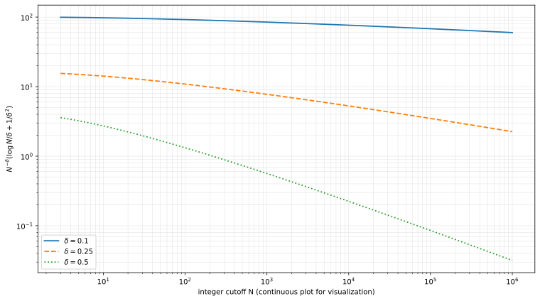

# Arithmetic side and prime cutoff

For real \(\sigma>1\),

\[
\frac{\xi'}{\xi}(\sigma)=
\frac1\sigma+\frac1{\sigma-1}-\frac12\log\pi
+\frac12\psi(\sigma/2)
-\sum_{n\ge2}\frac{\Lambda(n)}{n^\sigma}.
\]

Let \(y=\sqrt{x}\), \(\sigma=1/2+y\), and for an **integer** cutoff \(N\ge3\) replace the infinite von Mangoldt sum by \(2\le n\le N\). If \(\delta>0\) and \(\sigma\ge1+\delta\), then

\[
\sum_{n>N}\frac{\Lambda(n)}{n^\sigma}
\le N^{-\delta}\left(\frac{\log N}{\delta}+\frac1{\delta^2}\right).
\]

The integer hypothesis matters: the direct sum–integral comparison is stated at the last included integer. After division by \(2y\), it bounds the arithmetic truncation error uniformly on intervals bounded away from \(x=1/4\).

`primeTail_summable_and_le` proves both summability and this bound for the
actual Mathlib von Mangoldt function, indexed by `N + (k + 1)`. It uses
`vonMangoldt_le_log`, the decreasing kernel on `[3, ∞)`, its antiderivative,
and finite sum–integral comparison. Uniform bounds on nonnegative partial
sums then give summability; no improper integral or RH premise is assumed.

`scaled_integer_primeTail_le` divides by `2a` for `a > 1/2`, retaining `N`.
`scaled_primeTail_le_of_integer_square` reaches `resolventPrimeTailMajorant`
only with the explicit equality `(N : ℝ) = lam²`. For an arbitrary real square,
retain `N = floor(lam²)` in the majorant (and require `N ≥ 3`); replacing it
directly by `lam²` is not justified. For example, at `δ = 20`, `σ = 21`,
`lam² = 63/16`, the omitted term `n = 4` alone exceeds that substituted
majorant. The existing nonnegativity lemmas do not assert a tail bound.

`tests/test_prime_tail_bound.py` checks representative finite partial tails,
the first omitted prime power, and this cutoff regression. Its decimal
computations are numerical smoke checks; the universal assertion is the
Lean theorem. This does not certify the surrounding completed-zeta identity
or instantiate a spectral error budget.
